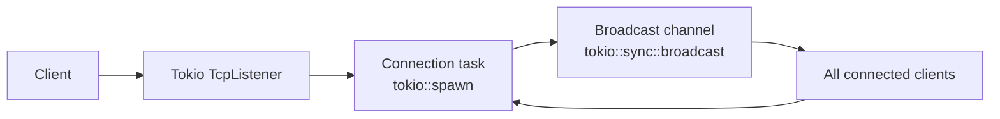

# TCP Chat Server


> A small, explainable TCP broadcast chat server built incrementally in Rust.

🦀 Rust · ⚡ Tokio · 🌐 TCP · 📣 Broadcast · 🧪 Tested

This project is developed with a **Spec-Driven Development** workflow: each
milestone is documented, implemented, and verified as a focused step.

## Project Overview

TCP Chat Server is a learning-focused Rust project for exploring TCP
networking, asynchronous I/O, task ownership, and multi-client communication.
It started as a synchronous `std::net` echo server, evolved into a Tokio-based
asynchronous server, and now supports newline-delimited broadcast messages for
multiple connected clients.

The server listens on `127.0.0.1:8080`. A message received from one client is
broadcast to every currently connected client, including the sender.

## Highlights

- Synchronous TCP echo server using `std::net`
- Tokio asynchronous TCP server
- One `tokio::spawn` task per connection
- Multi-client broadcast chat
- Newline-delimited message protocol
- Per-connection disconnect cleanup
- Automated Tokio test coverage
- Manual multi-client verification with `netcat` (`nc`)

## Spec-Driven Development

This project is intentionally developed through **Spec-Driven Development**:

- Every milestone is documented and planned before implementation.
- Requirements, architecture, tasks, and technical decisions are recorded in
  dedicated project documents.
- Changes stay small, explainable, and easy to verify.
- Automated checks and manual scenarios are kept alongside the implementation
  as acceptance criteria.

The planning documents are:

| File | Purpose |
| --- | --- |
| `docs/spec.md` | Requirements, protocol rules, and verification scenarios |
| `docs/architecture.md` | Current system structure and connection lifecycle |
| `docs/tasks.md` | Milestone and implementation status |
| `docs/decisions.md` | Recorded technical and architectural decisions |
| `agents.md` | Repository-specific instructions for development agents |

## Architecture



Each accepted TCP stream is handled by its own task. The task reads complete
newline-terminated lines and publishes them to the broadcast channel. It also
receives channel messages and writes them back to its client. EOF or a
connection read/write error ends only that task; the listener and other
clients continue running.

## Milestones

| Status | Milestone | Description |
| --- | --- | --- |
| ✅ Complete | Synchronous echo | Blocking `std::net` TCP echo server on `127.0.0.1:8080`. |
| ✅ Complete | Tokio async echo | Asynchronous listener with one Tokio task per connection. |
| ✅ Complete | Broadcast chat | Newline-delimited messages broadcast to all connected clients, including the sender. |
| ✅ Complete | Disconnect cleanup | EOF or connection errors end the affected task while other clients continue. |
| ✅ Complete | Verification | Automated test coverage and documented manual `nc` verification. |

## Tech Stack

- **Rust 2024 edition**
- **Tokio 1.54.1**
- `tokio::net::TcpListener`
- `tokio::sync::broadcast`
- Tokio features: `macros`, `net`, `rt-multi-thread`, `io-util`, `sync`
- No dependency beyond Tokio

## Getting Started

### Requirements

- A current Rust toolchain with Cargo
- `netcat` (`nc`) for manual client testing

### Clone and run

```bash
git clone https://github.com/Aqsin21/tcp-chat.git
cd tcp-chat
cargo run
```

The server starts on `127.0.0.1:8080`.

## Manual Verification

With the server running, open two or three additional terminals and connect
each one:

```bash
nc localhost 8080
```

If `localhost` is unavailable, use:

```bash
nc 127.0.0.1 8080
```

1. Type a message in one client and press Enter.
2. Confirm that the newline-terminated message appears in every connected
   client, including the sender.
3. Close one client.
4. Send another newline-terminated message from a remaining client.
5. Confirm that the remaining clients still receive messages.
6. Stop the server with `Ctrl-C`.

Every message must end with a newline. `nc` behavior can differ between macOS
and Linux. Pipe-based checks such as `printf 'hello\n' | nc localhost 8080` may
close the connection immediately after sending, so interactive terminals are
more reliable for checking broadcast delivery and disconnect behavior.

## Learning Goals

This project provides practice with:

- Ownership and borrowing
- `Result`-based error handling
- TCP streams and connection lifecycle
- `async`/`await`
- Tokio tasks
- Channels and message broadcast

## Automated Verification

```bash
cargo fmt --check
cargo check
cargo test
```

The automated test uses in-memory Tokio streams to verify that a message reaches
both the sender and another client, and that the remaining client can continue
after the first client disconnects.

## Future Enhancements

These features are **not implemented** in the current project scope:

- Usernames
- Authentication
- Persistent message history
- A more advanced protocol or framing format
- Graceful server shutdown
- Structured logging

## Learning in Public

Built incrementally with specs, tests, and small, verifiable steps.
